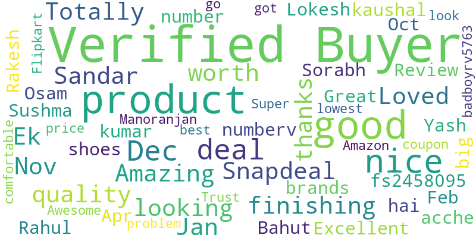

# 📊 Snapdeal Review Sentiment Analyzer

## 📖 Executive Summary
The Snapdeal Review Sentiment Analyzer is an end-to-end web scraping and Natural Language Processing (NLP) application. Built with Python and Flask, this tool automates the extraction of customer reviews from Snapdeal product pages, analyzes the underlying sentiment (Positive/Negative), and provides instant visual analytics. 

This project demonstrates proficiency in ETL (Extract, Transform, Load) processes, text analytics, and full-stack web development, making unstructured e-commerce data actionable.

## ✨ Key Features
*   **Automated Data Extraction:** Engineered a robust web scraper using `BeautifulSoup4` and `requests` to bypass static HTML structures and extract user reviews dynamically.
*   **Natural Language Processing (NLP):** Integrated `TextBlob` to calculate sentiment polarity, effectively categorizing unstructured text into actionable 'Positive' and 'Negative' metrics.
*   **Dynamic Data Visualization:** Leveraged Matplotlib to generate real-time bar charts comparing sentiment volume, automatically handling image rendering and UUID-based file management.
*   **Lexical Analytics:** Implemented the `wordcloud` library to process aggregated review text and highlight frequently occurring keywords, providing instant product insight.
*   **Interactive UI/UX:** Developed a responsive, CSS-styled frontend utilizing Google Fonts ('Poppins') for a modern, user-friendly analytical dashboard.

## 📈 Dashboard & Analytics

### Sentiment Distribution
*Automated bar chart generation visualizing the ratio of positive to negative feedback extracted from customer reviews.*


### Keyword Word Cloud
*Visual aggregation of the most prominent words extracted from customer reviews.*


## 🛠 Technical Architecture

| Category | Technology/Library | Purpose |
| :--- | :--- | :--- |
| **Backend Framework** | Flask | Request routing and server-side logic |
| **Web Scraping** | Requests, BeautifulSoup4 | DOM parsing and data extraction |
| **Data Science / NLP** | TextBlob | Sentiment polarity scoring |
| **Data Visualization** | Matplotlib, WordCloud | Graphical data representation |
| **Frontend UI** | HTML5, CSS3, Jinja2 | Responsive user interface design |

## 🚀 Local Installation & Setup

1. **Clone the Repository**
   ```bash
   git clone [https://github.com/Yathiksha21/Web-scrapping.git](https://github.com/Yathiksha21/Web-scrapping.git)
   cd Web-scrapping
